  

## ⛩️ Sobre mí

Soy **Andrés V.**, desarrollador de software. Construyo aplicaciones y APIs, y practico arquitectura de software (N capas/MVC y hexagonal).

> 🌸 *Me muevo hacia los retos con iniciativa, y cada proyecto es una oportunidad para hacerlo mejor que el anterior.*

- 🔭 Actualmente: migrando un proyecto de N capas/MVC a arquitectura hexagonal
- 🎓 Formación: Independiente / Tecnologia - Sena / Alura Latam 
- 📫 Contacto: [Discord](https://discord.com/users/465293378708307978) · [Instagram](https://www.instagram.com/andruv2006)

## 🎮 Stack y herramientas

Basado en mis repositorios públicos:

- 🕹️ **Lenguajes:** Java · Kotlin · Python · JavaScript · CSS · Jupyter Notebook
- 🍵 **Frameworks y librerías:** Spring Boot · JPA · JUnit 5
- 💾 **Datos y backend:** H2 · Supabase · PostgreSQL · MariaDB/MySQL
- 🏯 **Enfoques:** Arquitectura N capas/MVC · Arquitectura hexagonal · APIs REST

## 🗻 Proyectos destacados

- 👾 **[MiCajaPlus](https://github.com/Kasuma182006/MiCajaPlus)** (Kotlin): app para pequeños comerciantes con inventario, ventas, costos, fiado y estadísticas. Su backend está en [BackendMiCajaPlus](https://github.com/Kasuma182006/BackendMiCajaPlus) (Python).
- 🏯 **[Proyecto_Arquitectura_Hexagonal](https://github.com/Kasuma182006/Proyecto_Arquitectura_Hexagonal)**: migración de un proyecto N capas/MVC a arquitectura hexagonal.

## 🎴 Repositorios recientes

<!-- REPOS:START -->
| 📦 Repositorio | 📝 Descripción | 🕹️ Lenguaje | 📅 Creado |
| --- | --- | --- | --- |
| [Proyecto_Arquitectura_Ncapas-MVC](https://github.com/Kasuma182006/Proyecto_Arquitectura_Ncapas-MVC) | proyecto para la gestión de personas con fines educativos (versión con más integraciones en el repositorio de arqutiectura hexagonal)  | Java | 2026-10-15 |
| [Proyecto_Arquitectura_Hexagonal](https://github.com/Kasuma182006/Proyecto_Arquitectura_Hexagonal) | Migración de un proyecto en arquitectura N capas / MVC  a una arquitectura Hexagonal, puedes encontrar el proyecto con la anterior arquitectura llamada " Proyecto_Arquitectura_ N_ capas / MVC " | Java | 2026-10-15 |
| [prueba_API_Bicicletas](https://github.com/Kasuma182006/prueba_API_Bicicletas) | API REST de alquiler de bicicletas · Prueba técnica en Java 21, Spring Boot, JPA/H2 y JUnit 5. Reglas de negocio de tarificación y validaciones de estado cubiertas por pruebas. | Java | 2026-09-07 |
| [backendEntySoftware](https://github.com/Kasuma182006/backendEntySoftware) | Proyecto para la creación de un sistema de menús para propietarios de locales pequeños, con el que podrán manejar pedidos, gastos e ingresos y generar reportes | Java | 2026-05-27 |
| [MiCajaPlus](https://github.com/Kasuma182006/MiCajaPlus) | Esta aplicación está diseñada para apoyar a pequeños tenderos en la gestión de su negocio. Permite llevar el control del inventario, registrar ventas, costos y gastos, administrar créditos a clientes y visualizar estadísticas básicas sobre el rendimiento de la tienda. | Kotlin | 2026-02-23 |
| [BackendMiCajaPlus](https://github.com/Kasuma182006/BackendMiCajaPlus) | Backend en python para la conexión con la base de datos para la app de tenderos: https://github.com/Kasuma182006/MicajaPlus | Python | 2026-02-22 |
<!-- REPOS:END -->
